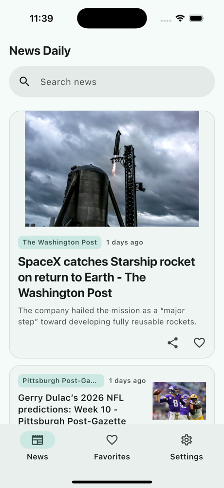
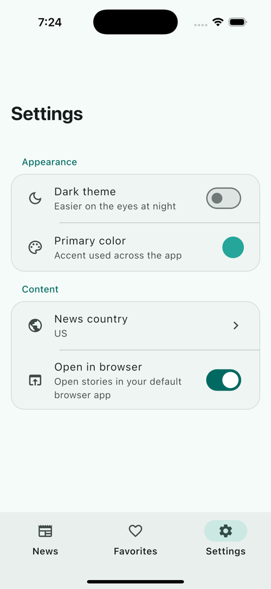

# News Daily

A news reader built with Flutter 3.50 and Material 3. It shows top headlines from [NewsAPI](https://newsapi.org), lets you search stories, save favorites, and pick the theme, accent color and news country.

<p align="center">
  
  
  
</p>

## Features
* **Feed:** top headlines as Material 3 cards with the source, publish time, preview, share and favorite actions
* **Search:** full-text news search
* **Favorites:** saved stories are stored locally on the device with `shared_preferences`
* **Settings:** light and dark theme, primary accent color, news country, and opening stories in the in-app WebView or the default browser

## Tech
* Flutter 3.50 / Dart 3.10, Material 3
* BLoC pattern with `rxdart` streams
* iOS uses Swift Package Manager and the UIScene lifecycle (no CocoaPods)

### Libraries
* [rxdart](https://pub.dev/packages/rxdart)
* [http](https://pub.dev/packages/http)
* [webview_flutter](https://pub.dev/packages/webview_flutter)
* [url_launcher](https://pub.dev/packages/url_launcher)
* [shared_preferences](https://pub.dev/packages/shared_preferences)
* [share_plus](https://pub.dev/packages/share_plus)
* [adaptive_theme](https://pub.dev/packages/adaptive_theme)
* [uuid](https://pub.dev/packages/uuid)

## Getting started
```bash
cd news_app
flutter pub get
flutter run
```

## License
Released under the [MIT license](LICENSE).

## Author
Kirill Adeshchenko ([@kaparray](https://www.linkedin.com/in/kirill-adeshchenko-b86362161/))
