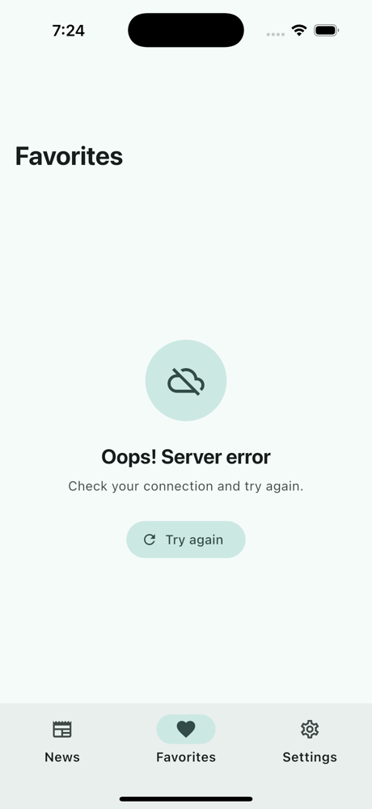

# News Daily

A news reader built with Flutter 3.50 and Material 3. It shows top headlines from [NewsAPI](https://newsapi.org), lets you search stories, save favorites, and pick the theme, accent color and news country.

<p align="center">
  
  
  
</p>

## Features
* **Feed:** top headlines as Material 3 cards with the source, publish time, preview, share and favorite actions
* **Search:** full-text news search
* **Favorites:** saved stories are stored locally on the device with `shared_preferences`
* **Settings:** light and dark theme, primary accent color, news country, and opening stories in the in-app WebView or the default browser

## Tech
* Flutter 3.50 / Dart 3.10, Material 3
* BLoC pattern with `rxdart` streams
* iOS uses Swift Package Manager and the UIScene lifecycle (no CocoaPods)

### Libraries
* [rxdart](https://pub.dev/packages/rxdart)
* [http](https://pub.dev/packages/http)
* [webview_flutter](https://pub.dev/packages/webview_flutter)
* [url_launcher](https://pub.dev/packages/url_launcher)
* [shared_preferences](https://pub.dev/packages/shared_preferences)
* [share_plus](https://pub.dev/packages/share_plus)
* [adaptive_theme](https://pub.dev/packages/adaptive_theme)

## Getting started

### Requirements
* Flutter 3.50 (stable) with Dart 3.10 or newer. Check with `flutter --version`
* Android: Android Studio with an SDK and an emulator or a device with USB debugging
* iOS: macOS with Xcode 16+ and an iOS 15+ simulator or device (dependencies are resolved by Swift Package Manager, no `pod install` needed)

### Run
```bash
git clone https://github.com/kaparray/NewsDaily.git
cd NewsDaily/news_app
flutter pub get
flutter devices          # list available simulators and devices
flutter run              # or: flutter run -d <device-id>
```

### Tests and static analysis
```bash
flutter analyze
flutter test
```

### Release builds
```bash
flutter build apk --release    # Android
flutter build ios --release    # iOS (needs signing set up in Xcode)
```
Android release signing is read from `android/key.properties` when that file is present; otherwise the debug key is used.

### NewsAPI key
News come from [newsapi.org](https://newsapi.org). The key lives in `_apiKey` in `lib/resources/news_api_provider.dart`. To use your own, register at newsapi.org and replace that value. The free plan is limited in requests per day.

## Architecture

The app follows the **BLoC** (Business Logic Component) pattern: the UI never talks to the network or storage directly, it only listens to streams and calls methods on the bloc.

```
UI (screens, views)  ──calls──▶  NewsBloc  ──▶  Repository  ──▶  NewsApiProvider ──▶ NewsAPI / SharedPreferences
        ▲                            │
        └──── Stream<NewsModel> ─────┘
```

### Layers (`news_app/lib`)
| Folder | Responsibility |
| --- | --- |
| `models/` | `NewsModel`, `Articles`, `Source`: plain data classes with `fromJson` / `toJson` |
| `resources/news_api_provider.dart` | Data sources: HTTP requests to NewsAPI (top headlines, search) and the local favorites store in `shared_preferences` |
| `resources/repository.dart` | Single entry point to data for the bloc; hides where each piece of data comes from |
| `blocs/news_bloc.dart` | Business logic. Exposes streams and actions for the UI |
| `ui/` | Widgets: `bottom_nav_bar.dart` (tabs), `screens/` (feed, search, favorites, settings, web view), `views/` (cards, stream builder, search bar), `theme.dart` (Material 3 theme) |
| `utils/` | Pure helpers: country codes, "time ago" formatting |

### How the BLoC works
* `NewsBloc` holds three `rxdart` `PublishSubject`s and exposes them as streams: `allNews` (feed), `searchNews` (search) and `likeNews` (favorites).
* Screens call `bloc.fetchAllNews()`, `bloc.fetchSearchNews()` or `bloc.fetchLikedNews()` in `initState` and on pull-to-refresh. The bloc asks the repository for data and pushes either a `NewsModel` or an error into the matching subject.
* Screens render the stream with a shared `streamBuilder` widget (`ui/views/stream_builder.dart`), which shows a loader, the list, an empty state or an error with a Retry button.
* Favoriting goes through `bloc.addFavorite` / `bloc.deleteFavorite`; `ui/utils/favorites.dart` also keeps the list of liked URLs so the heart icon state is instant.
* A single global `bloc` instance is created in `news_bloc.dart` and disposed when the app widget is disposed. `NewsBloc` and `Repository` accept their dependencies in the constructor, so tests can inject fakes (see `test/news_bloc_test.dart`).

### Local storage
`shared_preferences` (SharedPreferences on Android, NSUserDefaults on iOS) stores:
* `favorites`: liked articles as JSON strings
* `liked`: URLs of liked articles, for the heart icon
* `country`, `priorityTheme` and other settings; the theme mode is persisted by `adaptive_theme`

## License
Released under the [MIT license](LICENSE).

## Author
Kirill Adeshchenko ([@kaparray](https://www.linkedin.com/in/kirill-adeshchenko-b86362161/))
